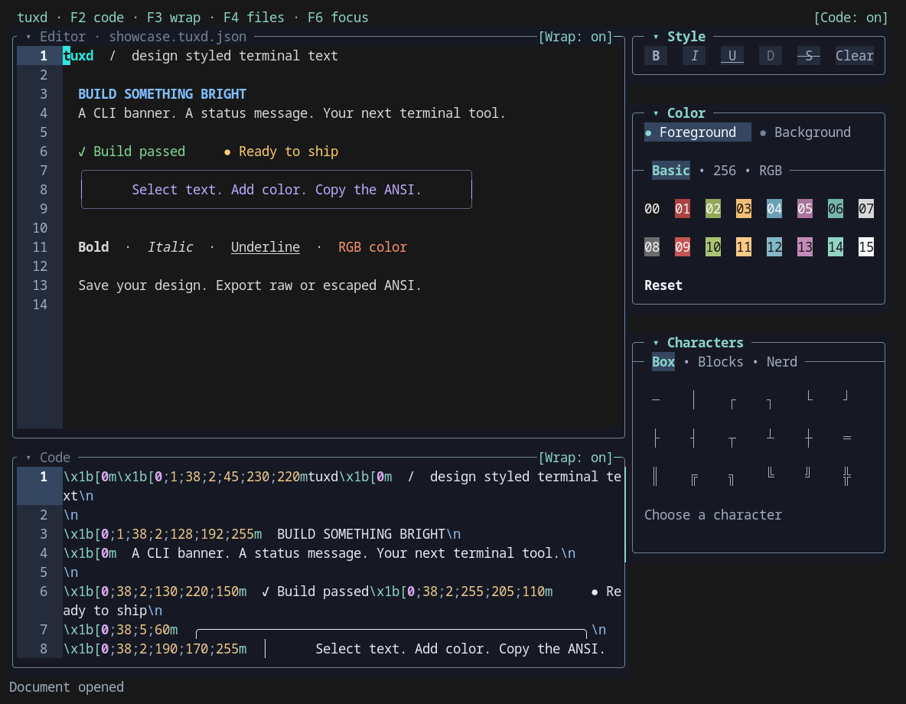

# tuxd

**Design styled terminal text. See the ANSI as you work.**

Build a colorful CLI banner, refine a terminal message, or inspect an existing ANSI snippet. tuxd gives you a visual text editor, styling tools, and a live ANSI view in one terminal application.

Select text, apply formatting, and copy the result into your project. Keep an editable `.tuxd.json` document for later, or export raw or escaped ANSI.



## From text to terminal output

- **Style visually.** Bold, dim, italic, underline, strike-through, and foreground/background colors, including all 256 indexed colors and RGB.
- **Inspect the result.** A read-only, syntax-highlighted Code pane updates alongside the editor. Copy the complete escaped ANSI output without gutters or display wrapping.
- **Bring existing text.** Import raw or escaped ANSI from files, clipboard, or stdin. Review unsupported controls before stripping them.
- **Edit comfortably.** Unicode-aware movement and selection, undo/redo, styled copy/cut/paste, and independent pane wrapping and scrolling.
- **Make it yours.** Configurable shortcuts, multi-key sequences, an optional leader key, and theme presets with per-role customization.
- **Work in a small terminal.** At 64 columns or fewer, Code and tools share a tabbed lower pane. Collapsing a pane gives its space to the other.

<details>
<summary>Watch a short editing demo</summary>


</details>

## Try it

The current target is **Linux with a UTF-8 terminal**. Building requires Rust 1.88 or newer and Cargo; the locked dependencies must also support your toolchain. A current stable Rust toolchain is recommended.

Install from a local checkout:

```sh
git clone https://gitlab.com/swivel/tux-design.git
cd tux-design
cargo install --path . --locked
```

Ensure Cargo’s binary directory (usually `~/.cargo/bin`) is on `PATH`, then:

```sh
tuxd --version
tuxd examples/welcome.tuxd.json
```

To try it without installing, run `cargo run --locked -- examples/welcome.tuxd.json` from the checkout. Registry installation and prebuilt downloads are not yet documented distribution channels.

## Create your first styled message

1. Run `tuxd` and type a message.
2. Select part of it with Shift+arrows or a mouse drag.
3. Choose a style or color in Tools. The Code pane shows the resulting ANSI.
4. Focus Code with a click or F6, then press Ctrl+C to copy escaped ANSI.
5. Press Ctrl+S to save an editable `.tuxd.json` document, or Ctrl+E to export.

Open **Settings with F1** to discover or change shortcuts. **F4** opens the File menu. **Ctrl+Q** quits, offering Save / Discard / Cancel when needed. These are default action bindings; Settings itself keeps fixed navigation and opening keys.

[Follow the getting-started guide →](docs/getting-started.md)

## Bring ANSI into the editor

```sh
# Actual ANSI escape bytes from a command.
printf '\033[36mHello, terminal\033[0m\n' | tuxd --raw -

# Literal escaped notation from a file.
tuxd --escaped examples/import-review.txt
```

Imports open as unsaved documents. Unsupported controls are listed for review; importing does not execute terminal commands or modify the source file. tuxd edits styled text rather than reconstructing terminal screens.

## Learn more

| I want to… | Read |
| --- | --- |
| Install and create my first document | [Getting started](docs/getting-started.md) |
| Learn selection, styling, tools, and clipboard behavior | [Editing and styling](docs/editing.md) |
| Save documents or import/export ANSI | [Files and formats](docs/files.md) |
| Customize shortcuts, leader sequences, and appearance | [Settings](docs/settings.md) · [Theme gallery](docs/themes.md) |
| Use command-line arguments and pipes | [CLI reference](docs/cli.md) |
| Resolve clipboard, terminal, font, or input problems | [Troubleshooting](docs/troubleshooting.md) |
| Understand or contribute to the implementation | [Development](docs/development.md) · [Architecture](docs/architecture.md) |

## Current scope

tuxd currently edits one document at a time and targets modest documents. There is no autosave, crash recovery, or external-change detection. Some composed emoji use a display-only escape fallback while preserving their original text. Clipboard forwarding and font/style support depend on your terminal environment.

See [compatibility and limitations](docs/troubleshooting.md) and the [product backlog](.work/deferred-work.md). Language/framework code generation, workspaces, and Vim mode are future work.

## License

[GNU General Public License v3.0 only](LICENSE) (`GPL-3.0-only`).

## Contributing and security

[Contribution guide](CONTRIBUTING.md) · [Report a vulnerability privately](SECURITY.md)

## Credits

Theme palettes adapted from [One Dark](https://github.com/atom/one-dark-syntax), [Dracula](https://github.com/dracula/dracula-theme), [Nord](https://github.com/nordtheme/nord), [Gruvbox](https://github.com/morhetz/gruvbox), [Solarized](https://github.com/altercation/solarized), [Tokyo Night](https://github.com/folke/tokyonight.nvim), and [Catppuccin](https://github.com/catppuccin/palette).

Built with [Ratatui](https://github.com/ratatui/ratatui), [Crossterm](https://github.com/crossterm-rs/crossterm), [ratatui-explorer](https://crates.io/crates/ratatui-explorer), [ratatui-which-key](https://crates.io/crates/ratatui-which-key), and the other packages in our [dependency notices](licenses/dependencies.txt).

See [third-party licenses and attribution](THIRD_PARTY_NOTICES.md) for retained notices and source details.
