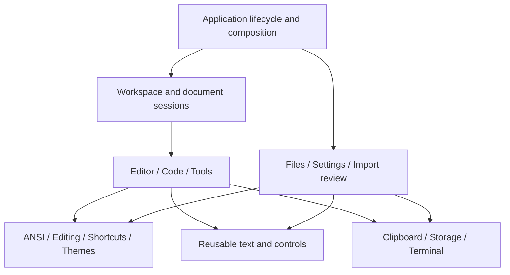

# Application architecture

Status: all eight refactor stages are implemented. This document describes the
current ownership and extension points in one Cargo package, with an independent
library target and an application binary.

The [refactor initiative](../.work/initiatives/composable-architecture/overview.md)
contains the source inventory, detailed contracts, implementation stages, and
verification ledger. [Readability guidance](code-organization-and-readability.md)
applies at every level of this design.

## Document buffers

Workspace owns an ordered set of buffers and one active buffer. Each buffer owns
its `DocumentSession`, Editor, Code projection/viewport, and Editor clipboard
transactions. Switching changes which buffer is composed into the panes; it does
not replace document content or reconstruct history.

`workspace/buffers.rs` owns insertion, switching, removal, and native-path identity.
`workspace/tabs.rs` paints the tab strip and records hit targets. Layout, pane focus,
collapse state, and tool instances remain workspace-wide. The active buffer is
stored separately so consumers can borrow its session and views together without
indexing or duplicating ownership.

App coordinates Save All and quit with queues of stable session IDs. Close targets
one ID. Pickers and prompts block buffer navigation; file failures retain the
pending operation. Clipboard completions are polled across all buffers and retain
their original session checks. Closing a buffer drops its pending transactions.

## Implemented boundary: Stage 1

`src/lib.rs` exposes `libraries::ansi`: private authoritative text/styles, checked
complete edits, raw/escaped parsing and encoding, diagnostics, and validated
serializable data. The binary uses this library; the library imports no app,
Ratatui, Crossterm, filesystem, or clipboard code. No new dependency or workspace
was introduced.

`adapters::native_document` owns the unchanged versioned JSON codec;
`adapters::ratatui` maps semantic styles for display. `features::code::projection` adds Code's
physical display rows. Copy and export call the document encoders directly.
Editor retains history/inheritance/viewport policy but no longer patches style
ranges or repairs document invariants.

The [Stage 1 record](../.work/initiatives/composable-architecture/stage-01-ansi.md)
details APIs, tests, and temporary bridges.

## Implemented boundary: Stage 2

`libraries::clipboard` owns environment-selected transports, worker requests,
request identity, typed receipts/errors, deadlines, and bounded helper I/O. It
knows nothing about ANSI, App, selection, focus, or user-facing messages. OSC 52
bytes are finalized by the terminal-owning thread between frames.

`features::code::Code` owns copy serialization and completion. Editor and fields
use the same service but keep their own target checks, mutations, and messages.
Root polling composes those owners; Code no longer enters Editor cut completion.
All application writes share one service write lane. Picker owns its read request
and completion; Files polls it through its public operation.

The [Stage 2 record](../.work/initiatives/composable-architecture/stage-02-clipboard.md)
records lifecycle behavior, tests, and remaining bridges.

## Implemented boundary: Stage 3

`libraries::editing::Editing` owns document, cursor/selection, pending style,
preferred column, revision, and history. It accepts semantic commands and pure
layout information; it imports no App, widgets, input events, themes, or files.
`libraries::text` owns fallback display, cell mapping, and viewport mechanics.

`DocumentSession` owns stable identity, Editing, path/origin, and saved checkpoint.
Dirty state compares content, so undo-to-saved still clears it. Async targets check
session identity independently of revision.

`components::text_surface` supplies rendering, clipping, gutters, cursor placement,
geometry, and local scrollbar interaction. Editor coordinates Editing with its
surface; Code supplies a read-only escaped projection and syntax styles; review
supplies inert original-source text and diagnostic marks. Code retains encoded
row offsets and source rows for the linked gutter. Derived content/layout are
rebuilt rather than cached, so content replacement, resizing, wrap, and appearance
cannot retain stale data. The generic scrollbar primitive knows no pane IDs.

Workspace now owns pane geometry and dispatch; Tools owns scrollbar routing.
The historical [Stage 3 record](../.work/initiatives/composable-architecture/stage-03-text-session.md)
details those bridges and verification.

## Implemented boundary: Stage 4

`libraries::shortcuts` accepts supplied descriptors, context rules, reserved keys and
key adapters. It owns serializable binding data, validation/compilation and sequence
resolution without application, terminal or filesystem imports. Ratatui-which-key
remains the matching engine. The application key adapter preserves Crossterm encoding.

Feature-owned descriptor slices assemble once into the stable catalog before saved
bindings load. Hidden panels remain represented; Settings and inline hints query the
same definitions/configuration. Existing IDs, defaults, categories and scopes remain.
File paths, bounded reads, legacy upgrades and atomic publication are application
storage responsibilities rather than resolver responsibilities.

Editor, Code, Files, pane coordination and fields handle their typed actions locally.
Root dispatch routes owners; focus coordination gives modals precedence and asks the
active control for its context. Pending-sequence and fixed Settings controls preserve
their existing lifecycle. Workspace owns pane policy; App owns modal precedence.

The [Stage 4 record](../.work/initiatives/composable-architecture/stage-04-shortcuts.md)
records validation and remaining bridges.

## Implemented boundary: Stage 5

`libraries::themes` owns typed roles/groups, presets, configuration and pure
resolution. Appearance consumes this catalog; no numeric role table remains.
`theme` adapts resolved appearance to Ratatui within a restoring render scope.
Its storage adapter accepts a path supplied by application configuration setup.

Settings has page-owned state and one exclusive interaction mode. General and
Shortcuts edit a single shortcut draft; Appearance previews a separate theme draft.
The shell owns fixed controls, navigation and lifecycle, with no whole-App access.
`configuration::commit` validates both drafts and preserves theme rollback when
shortcut publication fails. `app::settings` coordinates activation only on success.
Shared controls and atomic storage mechanics are implemented in their respective libraries.

The [Stage 5 record](../.work/initiatives/composable-architecture/stage-05-themes-settings.md)
details preserved formats/palettes, lifecycle tests and remaining bridges.

## Implemented boundary: Stage 6

`libraries::controls` supplies independent field, grid, range and cycle mechanics.
Picker, RGB and Settings share field operations while retaining input validation
and their existing visual presentations. Terminal field and scrollbar adapters
live in `components`; generic scrollbars contain no application target IDs.

Tools composes owned Style, Color and Characters state and layouts. It owns
selection, hit regions, scrolling, input and painting; the application consumes
typed effects for document edits, clipboard requests and focus. Color owns its
RGB draft and original-target paste completion. Sidebar/slim views use the same
instances. Drawing takes a read-only Editing borrow rather than App.

The [Stage 6 record](../.work/initiatives/composable-architecture/stage-06-controls-tools.md)
details consumers, policies and evidence. Workflow/storage ownership is complete in Stage 7;
final Workspace/root composition is Stage 8.

## Implemented boundary: Stage 7

Picker returns a typed path/operation selection; its action is no longer mirrored
in the Files dialog. Independent import review returns `Strip`/`Abort` and accepts
supplied presentation. `workflows::PendingReview` owns source identity, candidate
and document-versus-paste destination. Clipboard no longer depends on Files modal
state; delayed acceptance revalidates the original editing target.

`workflows::publication` encodes and publishes before updating session association.
`libraries::storage` supplies bounded stream/file reads and atomic byte publication.
Callers retain limits, no-clobber/replacement, permission and destination policies.
Theme and shortcut adapters share JSON publication; configuration rollback restores
original bytes atomically but remains a best-effort two-file operation.

The [Stage 7 record](../.work/initiatives/composable-architecture/stage-07-workflows-io.md)
records contracts and evidence. Stage 8 completes the App/Workspace composition.

## Implemented boundary: Stage 8

| Owner | Current contract |
| --- | --- |
| `main` | Parse/load startup input, enter the terminal, run the event/completion loop |
| `app` | Assemble services/configuration; route modal precedence and cross-feature effects; order replacement/save/quit/review decisions |
| `workspace` | Own session, Editor, Code and Tools; reconcile normal/slim layouts; handle pane focus, wrapping, collapse and pointer interactions |
| `files` | Own picker/menu/prompt interaction and geometry; return typed cancel/activate/submit/copy effects |
| `features::editor::clipboard` | Own pending copy/paste, captured targets, paste policy and revalidation; return notices or review requests |
| `workflows::PendingReview` | Own candidate/source/destination; consume decisions into document or paste commits |
| `app::view` | Establish scoped appearance, render Workspace and layer modals |
| `workspace::view` | Render pane composition from shortcut configuration, status text and focus availability |

Workspace applies document/focus tool effects locally; only clipboard requests and
notices escape to App. No feature, component or workflow implements App methods.
Application orchestration lives under `app/`; it borrows the relevant capabilities
instead of passing App into them. Files no longer owns exit or pending replacement
state. Clipboard transactions do not inspect modals: App supplies availability.

The root `styling` reexport, `ui` renderer and `editor_clipboard` coordinator are
removed. Production child modules use explicit imports. Geometry used only inside
Workspace/Files is private. Tests at the composition boundary deliberately exercise
the assembled owners; independent Workspace tests need no App or clipboard service.

The [Stage 8 record](../.work/initiatives/composable-architecture/stage-08-composition.md)
contains the final validation and the limits of device coverage.

## Simplify before separating

Scalability comes from simplification and separation of responsibilities at every
level: statements, meaningful statement groups, functions, objects, components,
subsystems, libraries, and their composition. Relocating complex code without
reducing what callers must know is not sufficient.

For each responsibility, ask:

- What is unique to it: its data, rules, invariants, and reasons to change?
- What mechanics or transformations can it completely own and isolate?
- What decisions remain with its caller, and how should the caller orchestrate them?

A useful capability behaves like a small library. Its operations are complete;
callers do not repair internal state or know the sequence of private steps. A
panel orchestrates controls, data, and services, just as a larger subsystem
orchestrates panels. Keep one Cargo package initially, with a library target and
application binary; extraction into separate packages is optional, not the goal.
Do not add a plugin system, service locator, generic event bus, or trait hierarchy
to imitate a larger application.

## Vocabulary

| Term | Meaning |
| --- | --- |
| Library | An independently understandable capability with a deliberate public contract |
| Subsystem | Capabilities/components accomplishing a broader cohesive responsibility |
| Area | Related responsibilities within a subsystem |
| Component | A model, control, view, service, or local coordinator with owned state and lifecycle |
| Adapter / driver | Integration with a particular format, framework, terminal, or external system |
| Orchestrator | The owner of ordering and policy when combining smaller capabilities |
| Session | Application identity and lifecycle for a document and its editing state |
| Projection | Derived presentation data, never a competing authoritative document |

These terms describe responsibilities, not mandatory directory depths or a class
hierarchy. A capability can begin with one file and ordinary functions.

## Independent capabilities

| Capability | Owns | Inputs and results | Must not know about |
| --- | --- | --- | --- |
| ANSI / styled document | Text, styles, mutations, sequence semantics, parsing and conversion | Validated documents, fragments, edits, representations, diagnostics | Panels, clipboard, paths, focus, UI themes |
| Editing | Cursor, selection, typing state, undo/redo, edit grouping | Semantic commands, document edits, history transitions | Raw terminal events, keybindings, dialogs |
| Shortcuts | Catalog lookup, bindings, validation, matching | Registered metadata, keys, contexts, time; action identities and diagnostics | Concrete panels, Settings views, document mutation |
| Themes | Role/preset catalogs, overrides, validation, resolution | Configuration and resolved themes | Settings navigation, paths, active panels |
| Clipboard | Transport choice, capabilities, reads/writes, completion | Text and request identities; receipts/errors | ANSI semantics, selections, cut policy, application messages |
| Presentation | Text display, controls, layout, navigation mechanics, hit testing | Content, state, geometry, appearance; local interactions | Persistence, application commands, document policy |
| Storage | Bounded reads, atomic publication, filesystem errors | Paths, bytes, limits, write policies | Document schemas, binding validation, dirty prompts |
| Terminal | Setup/restoration, input adaptation, serialized output | Terminal events and output operations | Features, document formats, configuration editing |

Document-style conversion into Ratatui styles belongs to an adapter. Features
contribute action/context definitions to a catalog; the resolver does not name
application views. Theme role data describes appearance without importing App.

## Application composition



The root starts services, loads configuration, constructs feature assemblies,
routes input/completions, composes frames, and exits safely. Features handle their
own actions. Cross-feature policy has an explicit application owner rather than
an ever-growing action match or an implicit global callback network.

| Application owner | State and decisions |
| --- | --- |
| Document session | Stable identity, editing session, file association, provenance, saved checkpoint |
| Workspace | Active session, pane arrangement, focus, normal/slim composition |
| Editor panel | Viewport and interaction; editing, presentation, clipboard transactions |
| Code panel | Read-only viewport, wrapping, derived projection; serialization, highlighting, copy |
| Tools | Style/Color/Characters components, local focus, staged RGB input |
| Document workflows | Pending new/open/save/close/import/export operations and decisions |
| Settings shell | Drafts, navigation, fixed controls, preview/save/cancel coordination |
| Import review | Source preview, diagnostics, navigation, accept/abort result |

One document is authoritative inside each editing session. Panels borrow it or
hold invalidatable projections. Existing snapshot history can remain; a rope,
piece table, operation-log history, or multi-file implementation is not required.

## Dependency and state rules

1. Libraries never import application or feature modules.
2. Editing uses the ANSI model. Wrapped movement consumes pure text-layout
	information, not a rendered widget or terminal backend.
3. Presentation accepts content and appearance. Drawing never edits a document,
	writes a file, or starts clipboard work.
4. Adapters translate contracts to external representations; they do not collect
	unrelated workflow policy.
5. Features receive focused dependencies or short-lived borrows, not `&mut App`
	or a universal service context.
6. Components own geometry and hit regions. Scrollbars know orientation and
	extent, not Editor/Code/Tools identifiers.
7. Definitions register once per assembly. Hiding/remounting a component does
	not rewrite bindings or remove actions from Settings.
8. Derived data invalidates on its actual inputs: session identity and revision,
	layout dimensions, display policy, and theme as appropriate.
9. Asynchronous results return to an identified request/owner. Current focus
	does not identify the original operation target.
10. Errors report facts. Feature views choose wording; CLI adapters choose
	command-line diagnostics and exit behavior.

Use typed identifiers where mixing values causes real mistakes: document identity
versus revision, source bytes versus display columns, theme roles versus list
positions, component identity versus shortcut scope. Avoid wrappers without a
concrete reduction in ambiguity.

## Text and representation boundaries

The document is structured text plus normalized styles. ANSI strings are inputs
and outputs. Mutations maintain grapheme-safe positions and style coverage;
deserialization constructs validated state.

Raw ANSI, escaped ANSI, and structured data are independent outputs. Code adds
presentation breaks/highlighting to escaped output; clipboard consumes the escaped
encoder directly. Output excludes selection overlays, themes, gutters, fallback
glyph notation, and soft wrapping.

Editor, Code, and review compose a shared text surface with explicit capabilities.
Editor supplies editable content, Code a read-only syntax projection, and review
inert source with diagnostic emphasis. Providers retain mappings between original
text, encoded text, and display cells. Read-only is enforced at the operation
boundary, not merely by omitting a shortcut.

Styling a range is a document operation. Visual wrapping is layout. Explicit
content reflow would be editing functionality and is not added in this refactor.

## Source organization

```text
src/
	main.rs                 # startup input and terminal event loop
	lib.rs                  # independent library entry point
	app/                    # assembly, modal routing, cross-feature coordination
	workspace/              # session/panes, layout, focus, mouse, pane descriptors
	session.rs              # identity, editing, path/origin, saved checkpoint
	features/
		editor/             # editing surface and guarded clipboard transactions
		code/               # read-only projection, highlighting, copy
		clipboard_notice.rs # caller-facing receipt/error wording
	panel/                  # Tools assembly; Style, Color/RGB, Characters
	files/                  # menus/prompts and picker interaction/presentation
	settings/               # shell, page state, fixed input, views
	workflows/              # import review and file publication operations
	configuration/          # config paths, JSON publication, settings commit
	shortcuts/              # application descriptors, key/storage/runtime adapters
	theme/                  # application storage and scoped Ratatui appearance
	components/             # reusable terminal fields, text surface, review, scrollbars
	libraries/
		ansi/               # model, complete edits, parsing, encoders, structured data
		editing/            # commands, selection, history
		shortcuts/          # supplied catalog, bindings, resolution
		themes/             # roles, presets, pure resolution
		clipboard/          # service, capabilities, drivers
		text/               # pure display/layout and viewport mechanics
		controls/           # field, grid, range and cycle mechanics
		storage/            # bounded reads and atomic publication
	adapters/               # native document codec and semantic-style rendering
	persistence.rs          # document-specific read/write policies
	terminal.rs             # setup, restoration and controlling-TTY handoff
	cli.rs                  # OS-string parsing and bounded stdin input
```

Module placement follows ownership; there is no requirement to make every
capability a separate crate or directory. The feature-specific adapters retain
their existing names. There are no remaining migration facades.

## Fractal readability

| Level | Review question |
| --- | --- |
| Statement | Do names and types communicate meaning and units? |
| Statement group | Are validate/prepare/transform/commit stages visible without excessive extraction? |
| Function | Does it complete an operation without caller repair? |
| Object | Does it protect invariants and directly represent valid states? |
| Component | Does it own interaction, lifecycle, and local orchestration? |
| Library/subsystem | Is the contract useful without understanding internals? |
| Application | Are policy and ordering explicit while mechanics are delegated? |

Equivalent responsibilities should be recognizable across consumers. Similar
syntax alone does not justify merging distinct policy. Prefer small functions and
enums until actual alternatives justify traits. Avoid catch-all utilities and
universal executors. A named stage or local value is often enough simplification.

## Implementation and extension

The refactor proceeded through ANSI document → Code → Clipboard and the remaining
consumers in independently verifiable stages. The [implementation plan](../.work/initiatives/composable-architecture/implementation-plan.md)
defines prerequisites, gates, and removal of temporary bridges.

Character search belongs with Characters; formatting-only clipboard uses document
styles and editing transactions; multi-file support adds sessions and navigation;
component-emoji work changes shared display strategy. Vim mode composes input and
editing. Code generation remains a separate discovery initiative consuming the
document capability. These placements do not add deferred features to this scope.

## Character discovery

`libraries/characters` owns the bundled Unicode/Nerd metadata, grouping, eligibility,
and deterministic search. `panel/characters` owns query editing, browse choices,
result navigation, and the bounded grid. Workspace applies glyph insertion through
Editing, preserving selection, typing styles, and undo. See the
[catalog maintenance guide](character-catalog.md) for the data and validation contract.
