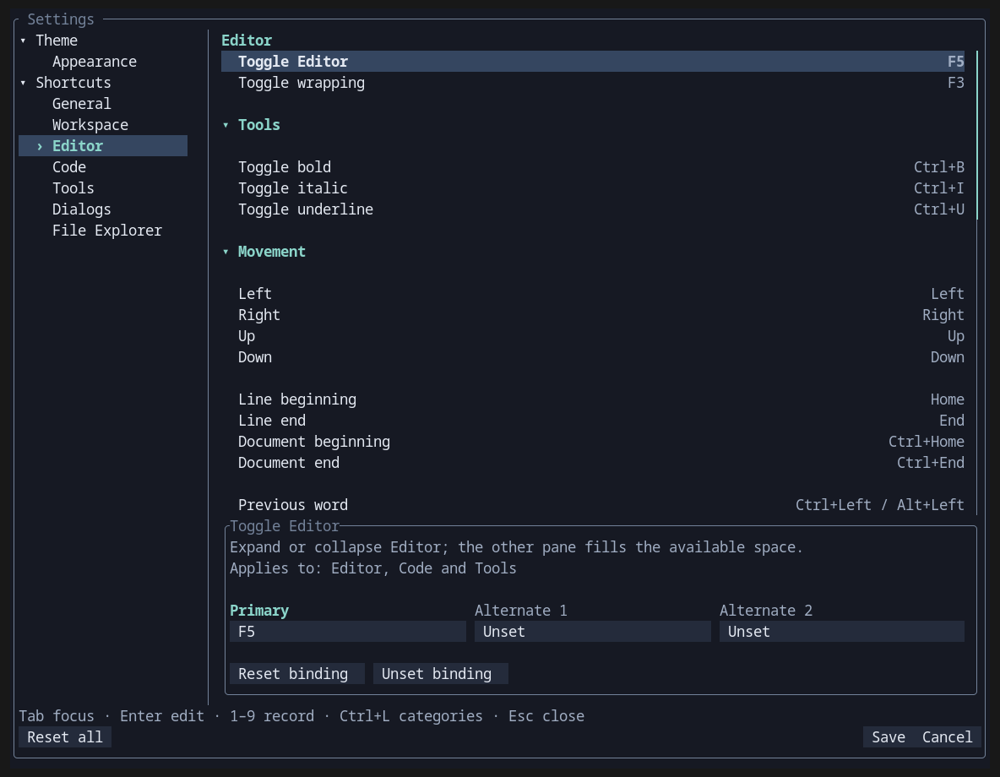

# Customize tuxd

[Documentation](README.md) · [Configuration reference](configuration.md)

**Choose a task:** [Change theme](#change-the-theme) · [Change a shortcut](#change-a-shortcut) · [Record a sequence](#record-a-key-sequence) · [Set a leader](#set-a-leader-key)

Press **F1**, **Ctrl+/**, or **Ctrl+,** to open Settings. It opens at the context you were using—even from a file dialog.

> **Save applies your changes.** Appearance previews immediately; shortcuts stay unchanged until you save. Cancel lets you discard the draft.

## Change the theme

1. Open **Theme → Appearance**.
2. Focus the preset field and press **Enter**.
3. Use arrows or **j/k** to preview presets.
4. Press **Enter** to accept the preset, or **Esc** to cancel the chooser.
5. Choose **Save** or press **Ctrl+S** to keep your changes.

Midnight is the default. [Browse the theme gallery](themes.md) to compare every preset.

### Customize a color

1. In Appearance, select a color role and press **Enter**.
2. Type or paste a color: `#80c0ff`, `ansi:60`, or `default`.
3. Press **Enter** to accept the field, or **Esc** to cancel the edit.
4. Save Settings.

| Reset action | Effect in the draft |
| --- | --- |
| A role’s Reset button, Delete, or empty value | Restore that role’s preset color |
| Reset theme | Clear color overrides for the selected preset |
| Reset all | Restore theme and shortcut defaults |

Changing the preset keeps custom overrides. Interface themes do not change document formatting or ANSI swatches.

## Change a shortcut

1. Choose a category under **Shortcuts**.
2. Select an action. Its description and binding slots appear below the list.
3. Focus **Primary**, **Alternate 1**, or **Alternate 2**.
4. Press **Enter**, then press the key combination to record.
5. Choose **Save** or press **Ctrl+S**.

| Binding control | Effect |
| --- | --- |
| Enter | Record one keypress |
| Delete / Backspace or Unset binding | Clear the selected slot |
| Reset binding | Restore that slot’s default |
| Esc during capture | Cancel capture |

### Find the right category

| Category | Includes |
| --- | --- |
| General | Leader and sequence timeout |
| Workspace | Files, pane focus, shared fields, text-field clipboard, range controls |
| Editor | Styling, movement, selection, editing |
| Code | Collapse, wrapping, scrolling |
| Tools | Tool-specific actions |
| Dialogs | Positive, negative, abort, and dismiss actions |
| File Explorer | File-list navigation, filters, location |

**Tip:** Copy, Paste, Select all, and field navigation are shared actions in Workspace. Configure them once for their applicable contexts.

## Record a key sequence

To bind an action to **Ctrl+W, then Right**:

1. Focus its binding slot.
2. Press **2** to request two inputs.
3. Press **Ctrl+W**, then **Right**.
4. Save Settings.

Use **1–9** to choose the input count. Capture displays what the terminal reports; some physical combinations are indistinguishable.

| Sequence behavior | Result |
| --- | --- |
| A complete binding matches | Action executes immediately |
| A prefix matches | Wait for the next input |
| Timeout, Esc, unmatched input, or context change | Pending sequence is canceled |
| Duplicate or ambiguous prefix in overlapping contexts | Binding is rejected |

The sequence timeout defaults to **1000 ms**. Change it under **General**; valid values are **1–60000 ms**. Ctrl+T focuses its editor.

## Set a leader key

1. Open **Shortcuts → General**.
2. Focus **Leader**, press **Enter**, then press the desired key.
3. Review any affected bindings and confirm if prompted.
4. Save Settings.

Leader starts unset. During binding capture, pressing it first records symbolic `<leader>` and waits for the requested number of following inputs.

| Change | Existing bindings |
| --- | --- |
| Set leader to a standalone bound key | Affected standalone bindings are unset after confirmation |
| Set leader to a sequence prefix | Affected sequences become symbolic `<leader>` sequences |
| Change leader | Symbolic bindings follow the new leader |
| Unset leader with Delete | Choose to preserve its literal key (`p`) or remove affected bindings (`r`) |

## Navigate Settings

These controls are fixed and cannot be rebound.

| Task | Control |
| --- | --- |
| Focus category navigation | Ctrl+L |
| Move | Arrows or h/j/k/l |
| Next / previous control | Tab / Shift+Tab |
| Activate | Enter |
| First / last / middle visible item | gg / G / M |
| Move a page | Page Up / Page Down |
| Collapse / expand sidebar group | Left / Right |
| Save | Ctrl+S |
| Reset all in the draft | Ctrl+R |
| Close / cancel | Esc |

On narrow terminals, a category selector replaces the sidebar. Mouse clicks, wheel scrolling, and scrollbar dragging also work.

If saving fails, Settings keeps the draft open. Canceling a changed draft offers **Discard** or **Keep editing**, with Keep editing initially focused.

**Reference:** [Configuration files and theme colors](configuration.md) · [Terminal key limitations](troubleshooting.md)
